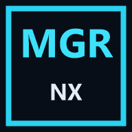

<div align=center>



</div>
<h1 align=center>mgr-nx-deko installer</h1>

The installer page of [mgr-nx-deko](https://github.com/tuancapoo/mgr-nx-deko), the native Nintendo Switch port of
Metal Gear Rising: Revengeance (Xbox 360): **https://tuancapoo.github.io/mgr-nx-deko-installer/**

You give it your own copy of the game (the folder you extracted the disc into) and it gives you a zip ready to extract
into the root of the SD card. Everything runs in your browser: the game files never leave your computer.

## What it does

1. Finds the game in the folder you chose: the shallowest `default.xex`, and `media/` beside it.
2. Identifies the game by the SHA-256 of `default.xex` and picks its build from `release/manifest.json`.
3. Downloads that build's NRO and checks its SHA-256. The NRO carries no translated game shader (only a table of
   numbers: hashes, constant masks, vertex input formats).
4. Makes the game's shaders from its own files: the 1,202 shader containers inside `media/data000.cpk` (read in place:
   the CPK table of contents and CRILAYLA decompression, `lib/cpk.js`), translated to HLSL by mgr-nx-deko's Renut
   translator (`wasm/renut_hlsl`), compiled to SPIR-V by DXC (`wasm/dxc_web`), turned into GLSL by SPIRV-Cross
   (`wasm/spirv_cross`), converted for deko3d (`lib/deko3d_glsl.js`) and packed (`lib/deko3d_package.js`) into
   `deko3d_glsl.bin`. The package must match the build's SHA-256. The console compiles each shader once, behind a
   progress screen at its first start, and keeps them in `deko3d_shaders.bin`.
5. Writes the zip: `mgr-nx-deko/mgr.nro`, `LICENSES.txt`, `deko3d_glsl.bin`, `mgr.toml` and the game folder as
   `game_root/` (`default.xex` and `media/`; the game is 7.5 GB, over FAT32's 4 GB file limit, so it is not packed into
   one file). The zip is streamed to disk through the service worker, so it never has to fit in memory.

The update zip holds only `mgr.nro`, its licenses and `deko3d_glsl.bin`: your `mgr.toml` stays.

## Layout

| Path | Contents |
|---|---|
| `index.html`, `app.js` | The page and its interface (English and Vietnamese, `lib/i18n.js`) |
| `worker.js` | Builds the package off the main thread |
| `sw.js` | Offline cache and the download stream |
| `lib/` | CPK reader, XEX reader, the deko3d shader chain (`deko3d*.js`), zip writer |
| `wasm/` | WebAssembly builds of Renut's translator (from mgr-nx-deko), DXC, SPIRV-Cross and the LZX decoder |
| `renut_shader_common.h` | The translator's HLSL header (mgr-nx-deko's `app/thirdparty/reblue-XenosRecomp/XenosRecomp/shader_common.h`) |
| `release/` | The list of builds, the NRO, its settings file and licenses |
| `test/` | Node scripts that run the same code as the page (`mgr_deko3d_node.mjs`, `package_node.mjs`, `cpk_node.mjs`) |

`wasm/renut_hlsl.*` is built from mgr-nx-deko's checkout with `wasm/src/deko3d/build_wasm_deko3d.sh renut_hlsl`
(`SA2_NX=<mgr-nx-deko checkout>`, Emscripten).

## Testing

```
python serve.py 8766 .
node test/mgr_deko3d_node.mjs <game folder> <native glsl folder> --json chain.json
node test/package_node.mjs out.zip <game folder> [--update]
```

## Credits

Built on [sa2-nx-installer](https://github.com/chanseyisthebest/sa2-nx-installer) by ChanseyIsTheBest, itself built on
[nfsmw-nx-installer](https://github.com/StevensND/nfsmw-nx-installer) by StevensND and peggle2-nx-installer's deko3d
shader chain. See [NOTICES.md](NOTICES.md) and `release/LICENSES.txt`.

## Legal

No affiliation with Konami, PlatinumGames, Microsoft or Nintendo. "Metal Gear Rising: Revengeance" is a trademark of
Konami Digital Entertainment. This page hosts no game data and no original game executable; you need your own legally
obtained copy. Licensed under the GNU GPL v3 (see [LICENSE](LICENSE)).
